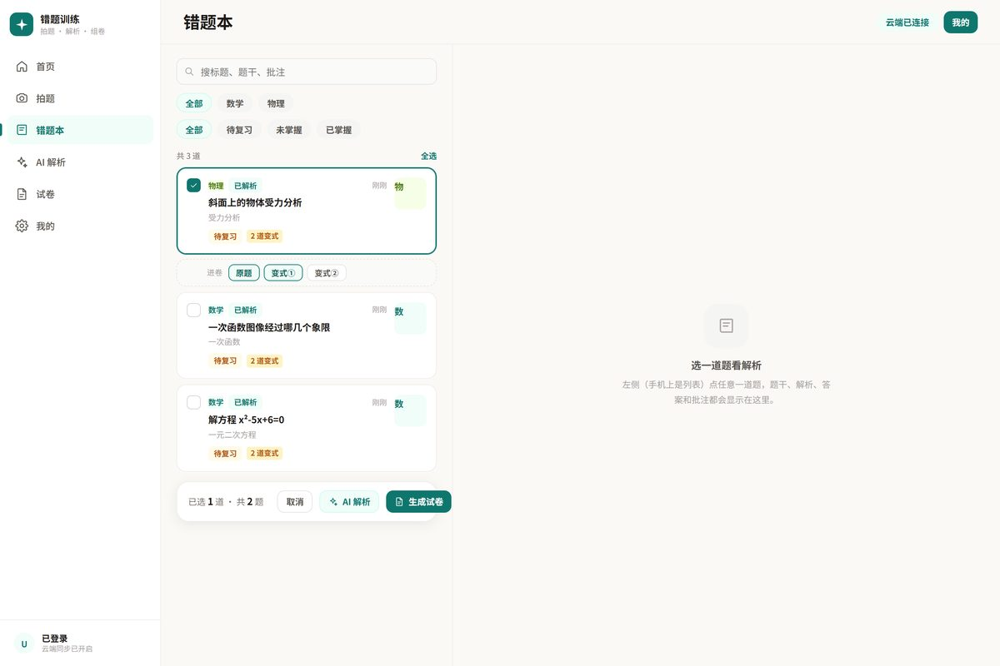
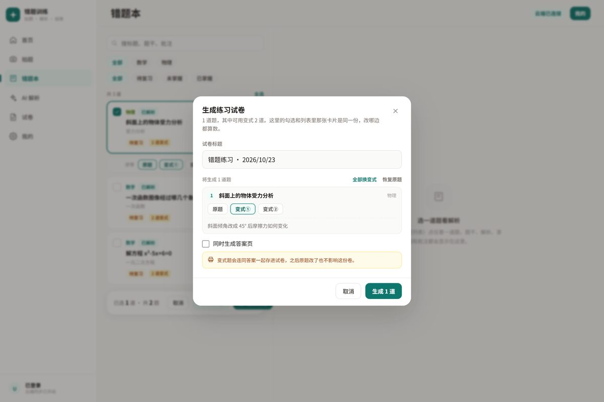

# 错题训练 · error_notebook

家里小朋友用的错题本：**手机拍题 → AI 分步解析 → 一键组卷打印**。
手机、平板、电脑共用一套数据，无需安装 App，浏览器打开即用。



## 它能干什么

| 环节 | 说明 |
|---|---|
| **拍题** | 手机直接调后置相机（`<input capture>`，内网 http 也能用），也可从相册选图或手打文字 |
| **错题本** | 按科目分类、标签筛选、搜索；每题可挂解析结果 |
| **AI 解析** | 勾选多道题 → 批量出「分步解答 + 最终答案 + 知识点 + 相似练习」 |
| **组卷** | 每道题可**选原题或某一道相似变式**，也可一键全部换变式；生成带答案/不带答案两种卷 |
| **打印** | 试卷页按 A4 排版，直接浏览器打印，空白卷给孩子做 |
| **多端同步** | 本地 IndexedDB 缓存 + 云端真源，断网可用，联网自动对账 |



## 在线使用

- GitHub Pages：`https://diiyoo.github.io/error_notebook/`（开启 Pages 后生效）
- 需要登录后才有云端数据；不登录则是纯本机模式，数据只在自己浏览器里

## 本地跑起来

纯静态，零构建、零依赖。**不能用 `file://` 直接双击打开**（IndexedDB 与模块作用域会受限），起一个静态服务即可：

```bash
git clone https://github.com/diiyoo/error_notebook.git
cd error_notebook
python -m http.server 8080
# 打开 http://127.0.0.1:8080
```

手机联调：电脑与手机同一 WiFi，手机访问 `http://<电脑内网IP>:8080`。

## 目录结构

```
index.html          入口，所有 js/css 都带 ?v= 版本号，防手机缓存
css/tokens.css      设计变量（颜色、圆角、阴影、字号）
css/app.css         全部样式，响应式：≤430px 走手机布局
js/config.js        云端连接配置（endpoint / publishableKey）
js/cloud.js         云端封装：Auth / Database / LLM，SDK 不可用时自动降级本机模式
js/db.js            IndexedDB 封装（mistakes / papers）
js/store.js         状态中枢：增删改查、选择态、同步算法（拉取→对账→推送）
js/router.js        hash 路由
js/ui.js            toast / 弹窗 / 图标 / 科目配色
js/icons.js         内联 SVG 图标
js/views/           home 首页 · capture 拍题 · books 错题本 · review AI 解析 · papers 试卷 · settings 我的
js/app.js           启动、导航渲染、文件自检
```

## 技术取舍

- **不引入框架**：整个站 241 KB，无 npm、无打包、无 CDN 依赖（SDK 除外）。改一行刷新就见效，家里老人也能维护。
- **照片不存 base64 到数据库主表**：错题图片单独存对象存储，表里只留路径，列表页不会因为一张图卡死。
- **试卷存"条目"而不是"题目 id 数组"**：
  ```js
  items: [
    { type: 'mistake', id: 'mk_xxx' },                                  // 引用原题，实时读最新内容
    { type: 'similar', fromId: 'mk_xxx', question: '…', answer: '…' }   // 变式存快照
  ]
  ```
  变式题不在错题本里、没有独立 id，所以必须存快照——这样原题后来被改或删掉，试卷内容也不会变。
- **同步用「拉取 → 对账 → 推送」**：以 `updatedAt` 较新者为准，冲突不会互相覆盖成空数据。
- **失败必须显性**：组卷失败会明确弹「试卷没写进去，请看 我的 → 程序自检」，绝不静默返回。

## 关于数据

- 未登录：全部数据在你自己的浏览器 IndexedDB 里，换设备看不到。
- 已登录：错题、试卷、照片同步到云端，按用户隔离。
- `js/config.js` 里的 `publishableKey` 是可公开的前端密钥（设计如此），权限由服务端行级规则控制；真正的隔离靠登录态，不靠藏 key。

## 分支与版本

- `main` — 当前线上版本
- 另有 NAS 自托管版（Python 标准库 + SQLite，零第三方依赖），不放本仓库

## License

家用项目，未选定开源协议。要商用或分发请先联系作者。
